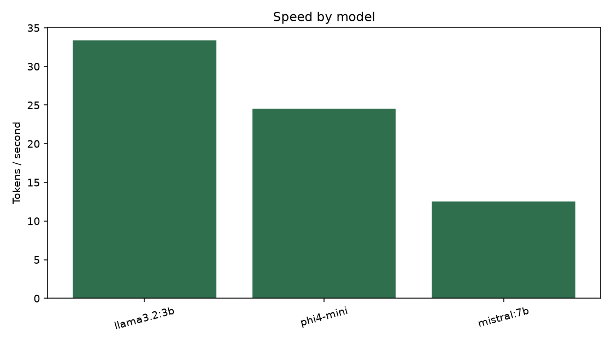
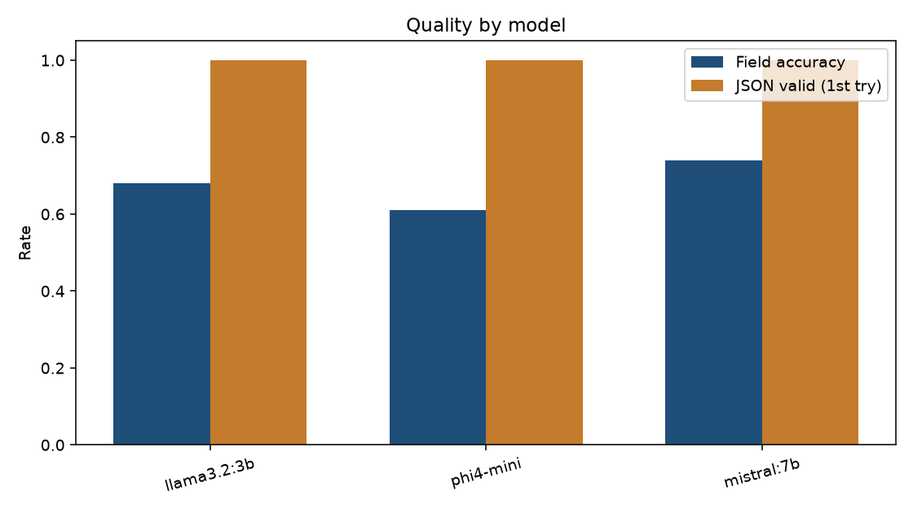
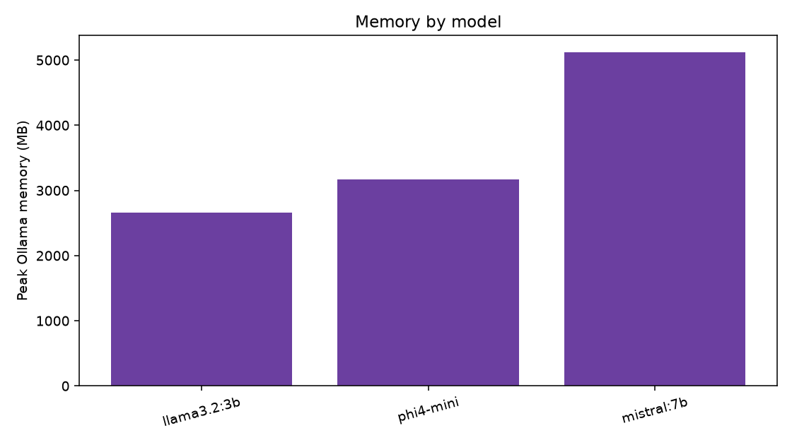

# Local LLM Benchmark Report

## Setup

| Field | Value |
|---|---|
| Chip | Apple M4 |
| RAM | 16.0 GB |
| macOS | 27.2.1 |
| Machine | arm64 |
| Task | Job posting → structured JSON (`JobPosting`) |
| Temperature | 0.0 |
| Eval set | 35 prompts in `bench/prompts/jobs.jsonl` |

## Method

- Each model is force-loaded once (`ollama run …`), then run on every prompt.
- Extraction uses Ollama `format=<JSON Schema>` + Pydantic validation + one retry.
- **JSON valid (1st try):** share of prompts valid without retry.
- **Field accuracy:** mean of per-field scores (exact/soft match for scalars, F1 for skill lists).
- **Peak RAM:** max `ollama ps` SIZE during that model's run (unified memory on Apple Silicon).
- **TTFT / tok/s:** from the extraction client metrics (non-streaming call: TTFT ≈ total latency).

## Results

| Model | Peak RAM (MB) | Load (s) | TTFT (ms) | Tokens/s | JSON valid (1st) | Field accuracy |
|---|---:|---:|---:|---:|---:|---:|
| llama3.2:3b | 2662 | 3.6 | 2392 | 33.4 | 100.0% | 68.0% |
| phi4-mini | 3174 | 2.8 | 3757 | 24.5 | 100.0% | 61.0% |
| mistral:7b | 5120 | 3.9 | 11091 | 12.5 | 100.0% | 73.9% |

## Charts







## Recommendation

For this job-extraction task on this machine, pick **mistral:7b**: field accuracy 73.9%, 12.5 tok/s, peak Ollama memory ≈ 5120 MB, first-try JSON validity 100.0%.

## Reproduce

```bash
make bench
```
